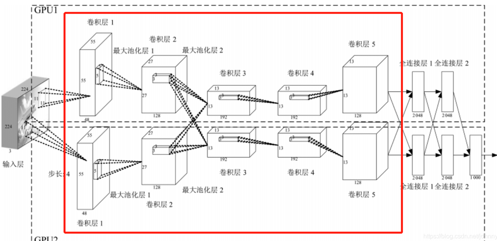

这篇发表在 CSDN 上的技术博文《【深度学习】一文搞懂卷积神经网络（CNN）的原理（超详细）》（作者：AI_dataloads）系统地梳理了卷积神经网络的核心原理与结构。

为你整理的 **Markdown 学习笔记** 如下：

---

# 深度学习笔记：卷积神经网络（CNN）原理详解

> **原文来源**：[CSDN · AI_dataloads](https://blog.csdn.net/AI_dataloads/article/details/133250229)
> **核心主旨**：从计算机图像本质出发，解析传统全连接网络的瓶颈，详细拆解卷积计算过程、超参数以及 CNN 的核心网络分层构造。

---

## 一、 图像的数字化表示

1. **数值矩阵**：
* 计算机中的图像本质上是由一系列数字组成的矩阵，每个像素值的取值范围通常在 **0 ~ 255** 之间（0 表示最暗/黑色，255 表示最亮/白色）。

2. **通道概念（Channels）**：
* **灰度图**：单通道，对应一个二维矩阵。
* **彩色图（RGB）**：由红（R）、绿（G）、蓝（B）三个通道叠加而成，在计算机中表示为三维张量（宽 $\times$ 高 $\times$ 通道数）。

---

## 二、 为什么要引入 CNN（对比传统神经网络）

* **传统神经网络（ANN/MLP）的缺陷**：
* **缺乏位置/平移不变性**：若同一物体出现在图像的不同位置（如左侧与右侧），传统全连接网络会将它们视为完全不同的输入，难以有效识别。
* **参数爆炸**：图像展平成一维向量后，全连接层的参数量极大，容易过拟合且计算代价高昂。

* **CNN 的优势**：
* 通过局部卷积操作和权重共享，捕捉局部的边缘、纹理特征，具备良好的**平移不变性（Translation Invariance）**。

---

## 三、 卷积（Convolution）与核心参数

### 1. 卷积计算的数学本质

* **操作方式**：将一个可滑动的小矩阵窗口（**卷积核 / Filter**）与输入图像的对应局部区域（**数据窗口**）进行**逐元素相乘后再求和**（若有偏置则加上偏置），输出一个数值。
* 滑动遍及整张图像后，生成一张新的特征图（Feature Map）。

### 2. 卷积过程中的核心超参数

1. **步长（Stride）**：
* 卷积核在输入矩阵上每次滑动的像素距离。步长越大，输出特征图的分辨率越小。

2. **卷积核数量（Depth / Number of Filters）**：
* 每个卷积核负责提取一种特定特征。卷积核的个数直接决定了输出特征图的**通道数（深度）**。

3. **零填充（Zero-Padding）**：
* **作用 1**：避免卷积后特征图尺寸逐渐萎缩，保持特征图的空间尺寸。
* **作用 2**：使卷积核能够充分覆盖到图像的最边缘区域，防止边缘信息丢失。

---

## 四、 卷积神经网络的标准构造

典型的 CNN 架构呈层次化级联，主要由以下层级组成：

| 结构层 | 核心功能与机制 |
| --- | --- |
| **1. 输入层 (Input Layer)** | 接收原始图像张量（如 $H \times W \times C$）。 |
| **2. 卷积层 (Conv Layer)** | 利用滑动卷积核提取局部特征，实现权值共享。 |
| **3. 激活层 (Activation Layer)** | 紧接卷积层之后，常用 **ReLU** 函数（$f(x) = \max(0, x)$），为模型引入非线性表达能力。 |
| **4. 池化层 (Pooling Layer)** | 对局部区域进行下采样（常用**最大池化 Max Pooling** 或**平均池化 Average Pooling**）。 

 • 降低特征图空间维度与计算量 

 • 抑制过拟合，增强特征的空间旋转/尺度鲁棒性 |
| **5. 多层堆叠 (Deep Stacking)** | 依次堆叠多个 `[Conv -> ReLU -> Pool]` 模块，逐级提取从低级纹理、几何边缘到高级语义特征。 |
| **6. 全连接与输出 (FC & Output)** | 将高维特征展平（Flatten）为一维向量，通过全连接层整合特征，最后通过 Softmax / Sigmoid 输出最终分类或回归预测。 |

---

## 五、 卷积效果直观理解

* **分层特征抽象机制**：
* **浅层卷积**：类似于人眼视觉初级处理，主要提取图像的边缘、线条、明暗对比和简单轮廓。
* **中深层卷积**：将基础边缘组合成复杂的局部结构（如纹理、部件）。
* **深层/输出端**：组合出高维抽象语义（如完整的五官、车轮、猫狗整体轮廓），最终完成识别任务。

## 六、 AlexNet经典网络结构

AlexNet 的前向传播流程可以划分为三个核心阶段：**双路特征提取**、**特征展平汇聚**与**全连接分类决策**。

---

**1. 双路特征提取阶段（Conv 1 ～ Conv 5）**

由于早期单卡显存受限，网络采用 GPU 1 与 GPU 2 双支路并行计算：

* **Conv 1 + Pool 1（初级边缘提取）**：
* 输入 $224 \times 224 \times 3$ 原始图像。
* 每张卡使用 48 个 $11 \times 11$ 大卷积核（步长 4）大跨步降维，各输出 $55 \times 55 \times 48$ 特征图。
* 紧跟 $3 \times 3$（步长 2）的重叠最大池化，尺寸下采样至 $27 \times 27 \times 48$。

* **Conv 2 + Pool 2（纹理与局部形状）**：
* 两卡保持独立计算，各使用 128 个 $5 \times 5$ 卷积核。
* 经池化下采样后，两卡各输出 $13 \times 13 \times 128$。

* **Conv 3（首次跨卡交互融合）**：
* 上一阶段两卡的输出在此汇聚互通，形成 $128 + 128 = 256$ 个输入通道。
* 每张卡各自使用 192 个 $3 \times 3 \times 256$ 卷积核，各自输出 $13 \times 13 \times 192$ 特征图（无池化）。

* **Conv 4（高级特征提取）**：
* 回归两卡独立计算，各使用 192 个 $3 \times 3$ 卷积核，维持 $13 \times 13 \times 192$ 尺寸（无池化）。

* **Conv 5 + Pool 3（深层抽象语义提取）**：
* 每张卡各用 128 个 $3 \times 3$ 卷积核。
* 紧跟最后一次重叠最大池化，空间分辨率被压缩至 $6 \times 6$，单卡输出 $6 \times 6 \times 128$。

---

**2. 展平汇聚阶段（Flatten & Concat）**

* **维度重塑**：将两张卡上的空间特征图直接展平为一维向量，单卡节点数为 $6 \times 6 \times 128 = 4608$。
* **跨卡拼接**：两路向量全面拼接汇总，形成长度为 $4608 + 4608 = 9216$ 的全局一维特征向量。

---

**3. 全连接与分类输出阶段（FC 6 ～ FC 8）**

* **FC 6（参数密集层）**：
* 将 9216 维向量映射到 4096 维（每卡各分配 2048 节点），参数量高达约 3770 万。
* 配合 **ReLU** 激活，并引入比例为 **0.5 的 Dropout** 抑制严重过拟合。

* **FC 7（非线性语义融合）**：
* 双卡全面交叉连接，维持 $4096 \to 4096$ 维变换，同样配置 ReLU 和 Dropout。

* **FC 8 / Softmax（最终分类）**：
* 4096 维映射到最终的 1000 维（对应 ImageNet 的 1000 个分类类别）。
* 经 Softmax 输出各分类标签的归一化概率分布。

